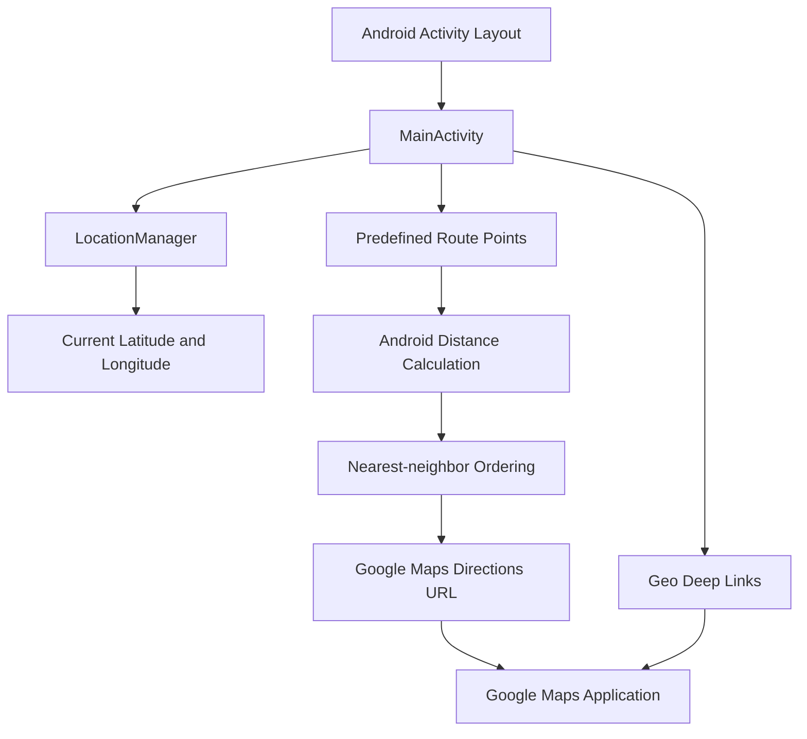

# Android Route Planner

Android application that calculates an efficient visit order for several Bogotá locations and delegates route navigation to Google Maps.

This repository is an Android laboratory project for location permissions, GPS updates, route selection, geospatial distance calculation, and deep links to Google Maps.

## Features

- GPS location permission handling
- Current-location updates through Android `LocationManager`
- Default origin at Universidad Piloto
- Multiple predefined route points
- Location links for Google Maps
- Nearest-neighbor route ordering
- Estimated straight-line distance
- Driving, cycling, walking, and transit modes
- Google Maps directions with origin, destination, and waypoints
- Graceful fallback when Google Maps is not installed

## Architecture



## Technology

- Java
- Android SDK
- AndroidX AppCompat
- Material Components
- Gradle Kotlin DSL
- Android location services
- Google Maps URI intents

## Route Algorithm

The efficient route uses a nearest-neighbor algorithm:

1. Start from the GPS position or default campus origin.
2. Find the remaining point with the shortest geodesic distance.
3. Add it to the route.
4. Repeat until all points are visited.
5. Calculate the approximate straight-line route distance.

This is a local heuristic, not an exact traveling-salesperson solution. It is fast and appropriate for an educational route-planning example, but it does not guarantee the shortest possible route.

## Google Maps Integration

The app opens individual locations with a `geo:` intent.

For complete routes, it constructs a Google Maps Directions URL with:

- Origin
- Destination
- Waypoints
- Travel mode

Supported modes:

- Driving
- Cycling
- Walking
- Transit

## Requirements

- Android Studio
- JDK 11 or newer
- Android SDK 24 or newer
- Google Maps installed for direct navigation
- Android device or emulator with location support

## Build

```powershell
.\gradlew.bat assembleDebug
```

The debug APK is generated in:

```text
app/build/outputs/apk/debug/
```

Run tests:

```powershell
.\gradlew.bat test
.\gradlew.bat connectedAndroidTest
```

## Permissions

The app requests:

- `ACCESS_FINE_LOCATION`
- `ACCESS_COARSE_LOCATION`

Location access is optional for route planning. Without GPS, the application uses the configured default origin.

## Limitations

- The route distance is an approximation using straight lines.
- Nearest-neighbor routing can be less efficient than an exact route search.
- Google Maps determines real road distance, traffic, and travel time.
- The route points are predefined sample locations.
- The project is primarily an Android learning exercise.

## Educational Value

The project demonstrates:

- Android Activity lifecycle
- Runtime location permissions
- GPS callbacks
- Intent-based external app integration
- XML layout structure
- Java collections and geospatial calculations
- Gradle Android module configuration
